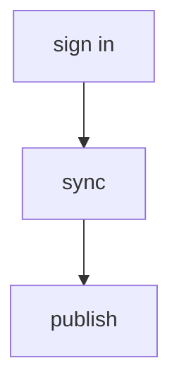

# Chat parts

Realness chat draws two Markdown fences as parts. Everything else shows as
text: raw HTML, images, and other fences stay plain.

Chat shows only the reply text. Write parts in the reply, never through a
command: tool output stays in the terminal.

## When

- Text first. A part earns its place or stays out.
- A flow, sequence, or hierarchy of four or more steps: a diagram.
- One page the reader should open: a card.
- A greeting, a yes or no, a short fact: text only.
- A comparison of fields: a Markdown table, which chat already shows.
- At most one diagram per reply. It replaces a step list; never repeat
  its steps in prose.

## Diagram

A `mermaid` fence. Chat draws it once the reply finishes.

````markdown

````

- `flowchart TD`: chat is a narrow column. Other kinds draw too.
- Labels in quotes, a few words each, ASCII only.
- No `click` lines or HTML in labels; chat draws them as text.

## Card

A `cardlink` fence of `key: value` lines.

````markdown
```cardlink
url: https://realness.online
title: Realness
description: A social network you run yourself.
```
````

- `url` must start with `https://` or `http://`, or the card stays text.
- `title`, `description`, and `host` are optional; write them from the page.
- Chat drops `image` and `favicon` so the reader's address stays private.

## Source

Parts are drawn by `apps/realness/tools/publish/renderer/static/scripts/parts.js`;
chat allows them in `apps/realness/src/app/utils/message-markdown.js`.
The parked plan is `vault/Areas/Realness/realness-chat-ui.md`.
