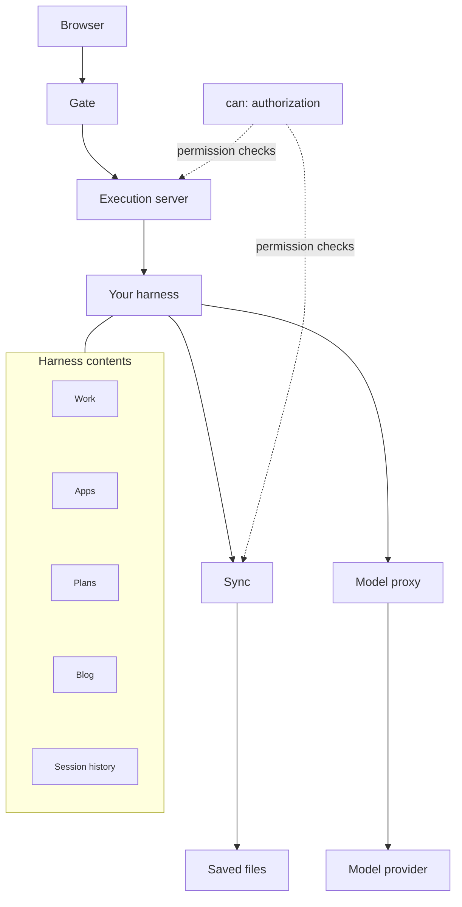

# Realness backend architecture

Realness gives each person a harness they can reach from a browser. It separates
running work from keeping work: machines can stop while saved files remain.

## The system

Lines without arrows show what the harness holds. Arrows show service connections.

There are two main paths:

- **Work:** browser -> gate -> execution server -> your harness.
- **Save:** your harness -> sync -> saved files.

Your harness calls models through the model proxy when it needs them.
Firebase supplies shared infrastructure: sign-in, file storage, and website
hosting. It supports these paths rather than being another step in every request.

## The five responsibilities

| Part             | Owns                                       | Why it is separate                                                               |
| ---------------- | ------------------------------------------ | -------------------------------------------------------------------------------- |
| Gate             | Checked entry and the browser connection   | People reach their environment without connecting directly to execution servers. |
| Execution server | Running isolated environments              | Machine lifecycle is separate from identity, file storage, and model spending.   |
| Your harness     | Pi, tools, instructions, and working files | Each person has a working environment isolated from other people's work.         |
| Sync             | Saved work outside the execution machine   | Files can survive a stopped or replaced machine and move between environments.   |
| Model proxy      | Model access and spending controls         | Model credentials and account limits stay outside the person's environment.      |

An execution server can run multiple isolated harness environments.
The code calls this server the **host**.
Gate, sync, and model proxy are services, not three more personal machines.
They serve many people.

## Gate: the shared front door

Gate connects the public browser app to the private execution system.

1. **Check identity.** It verifies who is connecting using Firebase sign-in.
2. **Forward the connection.** It passes browser requests to the execution server.
3. **Relay the conversation.** Chat and terminal traffic travel through gate in
   both directions.

The execution server still checks which environment that person may access.
Gate does not run Pi, hold working files, or make model calls. Those belong to
other parts of the system.

This boundary gives Realness one browser-facing entrance while the execution
servers stay behind it. Today, gate forwards to one configured execution server;
choosing among a fleet is not yet its responsibility.

## Inside your harness

The harness is the personal workspace: the projects you work on, the apps you
build, the plans that guide work, the writing you publish, and the history of
what you did. Pi and the tools operate on those contents.

These are parts of your workspace, not separate backend services. Sync preserves
selected contents; publishing makes selected output available to other people.

## The boundaries that matter

### Identity and permissions

- **Identity:** Firebase establishes who is calling.
- **Authorization:** `can` decides whether a caller may perform an action on a resource.
- **Enforcement:** execution server and sync apply permission checks before acting.

`can` is shared policy used inside services, not another server to call.
The dotted lines show that shared responsibility, not network traffic.
Model proxy keeps its own model-access and spending checks.

### Personal work and shared services

Your harness is personal. Gate, sync, and model proxy are shared.
The shared services check which person owns a request and what they may access.
One person's environment does not grant access to another person's files.

### Execution and persistence

The execution server supplies a place to work. Sync supplies continuity between places to
work. The machine's working disk and remotely saved files are separate copies.
Only saved work can be recovered after its execution machine is lost.

This separation lets Realness stop unused environments without treating a
person's work as disposable.

### Tools and model access

The harness decides what work to do and runs the tools. The model proxy supplies
controlled access to models. It does not run the harness or store its working
files.

This separates the cost and credentials of inference from the machine doing
the work.

## Follow one piece of work

1. **Enter.** You sign in. Gate connects your browser to your environment on an execution server.
2. **Work.** Pi and the tools run inside your harness. Model requests go through
   the model proxy.
3. **Save.** Sync carries selected files and session history to durable storage.
4. **Return.** An environment can recover that saved work. Continuing your work
   does not require keeping every process running forever.

The browser is a view into the environment. It is not the environment itself.
Closing that view and deleting the underlying work are different actions.

## Publishing is a separate output

Working files are private by default. Publishing creates a separate public
output. A saved static site can remain available without its original harness
running. A running application still needs compute.

The Realness browser app also has its own features, such as artwork and print
purchases. Those use shared infrastructure but are outside this harness
execution path.

## The architectural tradeoff

The separation adds service boundaries to manage. In return, Realness can
isolate people's work, save it independently of machines, and control model
access centrally.

The key idea is **a personal working environment backed by shared services**.
The machine is replaceable; the saved work belongs to the person.

## Check your understanding

Answer without looking at the diagram. Explain responsibilities, not code.

1. Draw the path from browser to harness. What does each part own?
2. Why are execution server and sync separate?
3. Can an execution server serve more than one person? Which parts are personal?
4. Why does the model proxy sit outside the harness?
5. What must be true before a machine can be lost without losing work?
6. What is the difference between closing the browser and losing the environment?
7. Why can a published static site survive its original harness?
8. Where does Firebase fit in this architecture?
9. How do identity, authorization, and enforcement differ? Where does `can` fit?
10. What does gate do, and what remains the execution server's responsibility?
11. Where do work, apps, plans, blog, and session history fit?

## Answers

1. Browser -> gate -> execution server -> harness. The browser presents the
   interface; gate controls entry; execution server manages execution;
   harness runs the person's work.
2. Running work and retaining work have different lifetimes. Saved files must
   survive the machine that produced them.
3. Yes. Each harness environment is personal and isolated; the services are shared.
4. To keep provider credentials and spending controls in a shared, trusted service.
5. The required files and history must have reached storage outside that machine.
6. The browser is an access point. Its connection can close while work remains
   on the machine or in saved storage.
7. Publication saves a separate output that can be served independently.
8. It supplies sign-in, storage, and hosting used by the product.
9. Identity establishes who calls; authorization determines what they may do;
   enforcement applies that decision. Execution server and sync use `can` as shared policy,
   not as a separate network service.
10. Gate verifies browser identity and relays connections. The execution server
    checks environment access and manages the machines that run the work.
11. They are contents of the personal harness, not shared backend services.
