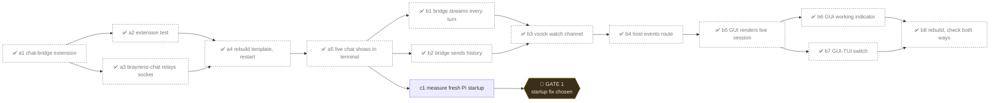

# Shared chat and terminal session

## Nodes

Struck-through ids are done.

| id        | goal                                                 | effort    |
| --------- | ---------------------------------------------------- | --------- |
| ~~a1~~ ✅ | Extension listens on socket, runs message in Pi      | medium    |
| ~~a2~~ ✅ | Unit test: delta, done, busy, bad input              | cheap     |
| ~~a3~~ ✅ | `brayness-chat` relays vsock to socket; no Pi spawn  | cheap     |
| ~~a4~~ ✅ | Rebuild template, restart `fc-local`                 | expensive |
| ~~a5~~ ✅ | Chat message appears in terminal; reply streams back | medium    |
| ~~b1~~ ✅ | Watchers get every turn, TUI-typed ones too          | medium    |
| ~~b2~~ ✅ | New watcher gets the session's messages first        | cheap     |
| ~~b3~~ ✅ | `brayness-chat` holds a long-lived watch connection  | cheap     |
| ~~b4~~ ✅ | Host streams watch events to the GUI page            | medium    |
| ~~b5~~ ✅ | GUI shows history and live turns from both sides     | medium    |
| ~~b6~~ ✅ | Pi's spinner and "Working" line above the input      | cheap     |
| ~~b7~~ ✅ | One control switches GUI and TUI views               | cheap     |
| ~~b8~~ ✅ | Rebuild; type in TUI, see it in GUI; reverse         | expensive |
| c1        | Find why fresh actors wait 39s, then Pi ~70s         | medium    |

## Notes

For a person using GUI and TUI on one actor.

### Decisions

- Gate 1 (a-series): approved; built directly.
- One Pi per actor: the terminal's, started at boot.
- Never start or restart Pi per chat message.
- Busy terminal Pi rejects chat: "terminal is busy".
- Pi not running: chat errors, no fallback Pi.
- Chat prompt appends only on chat-started turns.
- Guard on shipped chat prompt; seed Pi predates /etc/brayness.
- Free models skip the free token limit.
- Socket: `/run/brayness/pi-chat.sock`, interactive Pi only.
- Names: TUI is the terminal, GUI the chat page.
- GUI spinner copies Pi's frames: braille dots, 80ms.
- Switch: keep split; GUI, Both, TUI buttons; Ctrl+` cycles.
- GUI renders only from the watch; sending just posts.

### Open questions

- Should a closed browser abort the running turn?
- restore-fresh guards on /etc/brayness too; is it inert?
